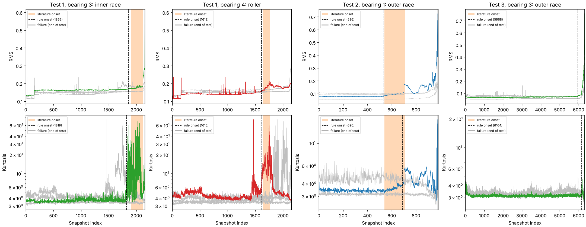

# Bearing Health Monitor

Predictive-maintenance portfolio project: health monitoring of rolling-element bearings on the NASA/IMS run-to-failure vibration dataset — from raw 20 kHz signals to features, anomaly models, honest evaluation and a small FastAPI service.

🚧 Work in progress. The project plan lives in [`docs/PROJECT_BRIEF.md`](docs/PROJECT_BRIEF.md).

## Setup

Requires Python 3.11 to 3.13; development uses **Python 3.12** (see `.python-version`).
TensorFlow 2.21 publishes Windows wheels for CPython 3.10 to 3.13 only and runs on the CPU there.

```powershell
# Windows (PowerShell)
py -3.12 -m venv .venv
.venv\Scripts\Activate.ps1
python -m pip install --upgrade pip
pip install -e ".[dev,dl]"
```

```bash
# Linux / macOS
python3.12 -m venv .venv && source .venv/bin/activate
pip install -e ".[dev,dl]"
```

No `py` launcher (e.g. Python from the Microsoft Store)? Create the venv with
[uv](https://docs.astral.sh/uv/) instead, then continue with the activation step above:

```powershell
uv venv --python 3.12 --seed .venv
```

The `dl` extra pulls in TensorFlow (large download) and is only needed for the autoencoder;
`pip install -e ".[dev]"` is enough for everything else.

Checks:

```bash
ruff check .
ruff format --check .
pytest
```

## Progress

- **Phase 0, data check:** dataset facts verified against the files, see [`data/README.md`](data/README.md).
- **Phase 1, exploration:** RMS and kurtosis trends over all runs; every failed bearing becomes
  visible about 2 to 4 days before the end of its test. See [`docs/exploration.md`](docs/exploration.md).



Reproduce the trend tables with `python scripts/compute_trends.py data/raw` (about a minute),
then run `notebooks/02_trends.ipynb`.
