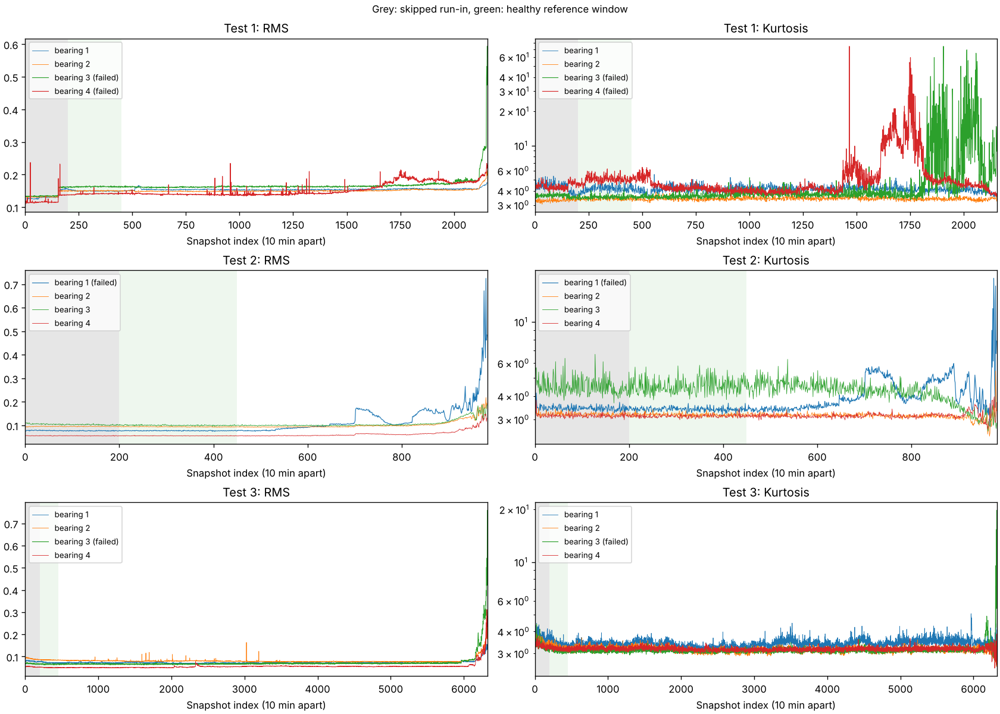
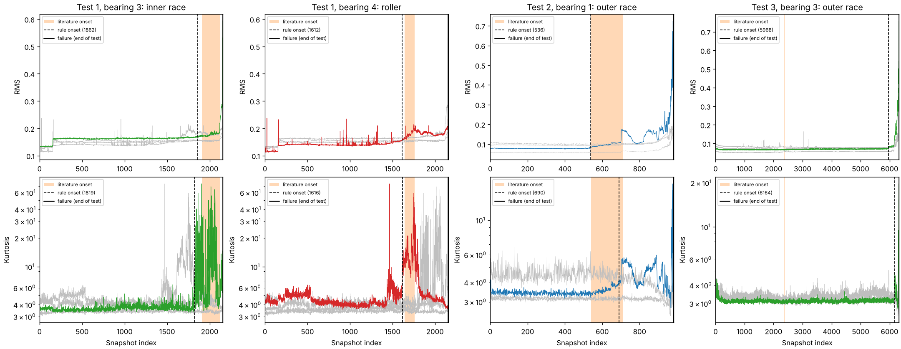

# Phase 1: Exploration – when does the failure become visible?

Every snapshot was reduced to RMS and kurtosis per bearing
(`bearing_monitor.trends`, `scripts/compute_trends.py`) and the trends were plotted over the whole
run of all three tests (`notebooks/02_trends.ipynb`). Flat-lined files at the end of tests 2 and 3
are dropped (see `data/README.md`). For test 1, which has two sensors per bearing, the larger value
of the two is shown. Snapshot indices are 0-based positions in the run; snapshots are 10 minutes
apart, except for the gaps in test 1.

## Onset rule (descriptive only)

To put numbers on "visibly abnormal", each trend is compared with a band of mean + 6 standard
deviations of its own early part: 200 snapshots are skipped as run-in, the next 250 form the
reference window (the training window planned for phase 3). The trend is smoothed with a trailing
median of 6 snapshots (1 hour), and the onset is the first snapshot from which it stays above the
band for 6 snapshots. This is a look at the data with hindsight, **not** the anomaly detector of
phase 3: nothing here was tuned on the evaluation and the numbers are not results.

| Test | Bearing | Defect | RMS onset | Kurtosis onset | Literature onset¹ | Last live snapshot |
|---|---|---|---|---|---|---|
| 1 | 3 | inner race | 1 862 | **1 819** | 1 910 – 2 120 | 2 155 |
| 1 | 4 | roller | 1 612 | 1 616 (first rise 1 441) | 1 641 – 1 760 | 2 155 |
| 2 | 1 | outer race | **536** | 690 | 539 – 710 | 981 |
| 3 | 3 | outer race | **5 968** | 6 164 | 2 367 (one method) | 6 322 |

¹ Zhang et al. 2019 (arXiv:1912.01096), table 2, earliest and latest of three methods.

Onsets of bearings that did **not** fail (RMS, 250-snapshot reference): test 1 bearing 1 at 522,
bearing 2 at 2 115; test 2 bearing 2 at 828, bearing 3 at 889, bearing 4 at 703; test 3 bearing 1
at 6 198, bearing 2 at 6 161, bearing 4 at 2 040.

## Findings

1. **The failure is visible in every failed bearing, about 2 to 4 days before the end of the test.**
   Test 2 bearing 1: RMS leaves its band at snapshot 536 (2004-02-16 03:52), about 74 hours before
   the end. Test 3 bearing 3: RMS at 5 968 (2004-04-15 15:32), about 59 hours before the end.
   Test 1 bearing 3: kurtosis at 1 819 (2003-11-22 14:16), 337 snapshots before the end.
2. **Kurtosis and RMS see different stages.** For the localized defects of test 1, kurtosis rises
   first and strongly (values up to 75): impacts from a local defect make the signal spiky. Later it
   falls back while RMS keeps rising, because spread damage makes the signal noise-like again. For
   the outer race failures of tests 2 and 3, RMS reacts first. Neither statistic alone is enough;
   this supports combining both in phase 2 and 3.
3. **Test 1, bearing 4 shows a first kurtosis burst at snapshot 1 441** (2003-11-19), 170
   snapshots before the sustained rise and before the literature range. It is short and the rule
   does not count it, but a detector that reacts to it would be early, not wrong.
4. **Our onsets agree with the literature for tests 1 and 2**, mostly at or slightly before the
   earliest published estimate. **Test 3 does not:** the literature onset 2 367 has no visible
   counterpart in bearing 3 (flat RMS and kurtosis until about 5 970). Instead **bearing 4** shows a
   step in RMS at snapshot 2 332 (2004-03-21 01:41) that decays over about 50 snapshots, and the
   rule also flags it at 2 040 with the 250-snapshot window. The published onset for test 3 may
   pick up this transient on the neighbouring bearing. We keep it as a reference only (as decided),
   and treat alarms between 2 040 and 2 400 in test 3 as a known pitfall in phase 3.
5. **The healthy bearings rise too near the end.** In all tests the non-failed bearings show higher
   RMS in the last hours, likely because the damaged bearing shakes the shared shaft. An alarm on a
   healthy bearing near the end is not necessarily a sensor error, but it is not a correct
   diagnosis of *which* bearing fails either.
6. **Test 1 has a level step at snapshot 156**, right after the 6.2-day pause (snapshot 155 on
   2003-10-23, snapshot 156 on 2003-10-29): RMS of all bearings jumps by about 15 % and stays
   there. Test 3 shows a slow downward drift of RMS and kurtosis during the first 300 to 400
   snapshots (run-in). Both have to be outside the training window, otherwise the "healthy"
   reference is wrong.
7. **The naive rule already raises false alarms on healthy bearings** (test 1 bearing 1 at 522,
   test 3 bearing 4 at 2 040). A fair baseline for phase 3 is therefore not trivial to beat but also
   not perfect.
8. **Test 2 is short.** With a 200-snapshot run-in, a 400-snapshot training window would end at
   snapshot 600, after the onset of bearing 1 at 536: the "healthy" training data would already
   contain damage (in a test run of the onset rule with that window, the RMS onset moved from 536
   to 651). This is why the upper sensitivity window was reduced to 300 snapshots (see below).

## Decision for phase 3: run-in and training window

**Decision (Alex, 2026-11-28):**

- **Run-in:** the first **200 snapshots** (about 33 hours) of every test are skipped. This covers
  the restart step of test 1 (snapshot 156) and the steepest part of the drift in test 3.
- **Training window:** the next **250 snapshots** (positions 200 to 449).
- **Sensitivity:** **150** and **300** snapshots, reported without picking the best. The upper
  value was originally 400; it was lowered to 300 so that the longest window (positions 200 to
  499) ends before the damage onset of test 2 at 536. Both the earliest literature onset (539) and
  the onset rule above agree on this limit.

Honest note: the limit of 300 was chosen after looking at the damage onset of test 2, so it uses
knowledge of that run. It only caps the training length so that every run has a damage-free
training window; it is not tuned for detection performance, and the main window of 250 was fixed
before.
