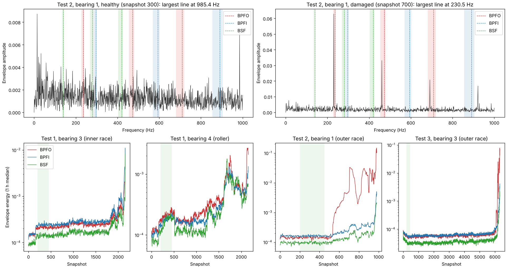

# Phase 2: Features

`bearing_monitor.features` reduces every snapshot to 23 numbers per channel
(`scripts/compute_features.py`, about two minutes on four cores). Test 1 has two sensors per bearing,
so it gets 8 × 23 = 184 feature columns, tests 2 and 3 get 4 × 23 = 92. The tables are written to
`data/processed/features_test{1,2,3}.parquet` (git-ignored) together with `file_index` and the
`flatline` flag of the dead files at the end of tests 2 and 3. Every feature is computed from one
snapshot alone; nothing is fitted, so the tables cannot leak information across time.

## Feature set

| Group | Features | Notes |
|---|---|---|
| Time domain | `rms`, `std`, `kurtosis`, `skewness`, `crest`, `p2p` | `rms` includes the DC offset (as in phase 1), `std` does not. Kurtosis is Pearson (3 for Gaussian noise). Crest = max. deviation from the mean / `std`. |
| Frequency domain | `band_0_1k` … `band_9_10k`, `centroid` | Welch PSD (Hann, 2048 samples, 50 % overlap, about 10 Hz resolution). Each band value is the signal power in that 1 kHz band; the ten bands sum to the variance. Centroid = power-weighted mean frequency. |
| Envelope spectrum | `env_{bpfo,bpfi,bsf}_{energy,ratio}` | Band-pass 1–9 kHz (Butterworth, 4th order, zero-phase), Hilbert envelope, FFT. Energy = sum of squared envelope amplitudes in windows around the fault frequency and its 2nd and 3rd harmonic. Ratio = that energy / envelope energy from 10 Hz to 1 kHz. |

## Bearing fault frequencies

Rexnord ZA-2115: 16 rollers per row, pitch diameter 2.815 in, roller diameter 0.331 in, contact
angle 15.17°. These values are the ones quoted in the IMS literature (Qiu et al. 2006, J. Sound Vib.
289, 1066–1090); they are **not** in the dataset readme and were not checked against a Rexnord
datasheet. Recomputed with the standard kinematic formulas
(`BearingGeometry.fault_frequencies`, tested) at 2000 rpm (33.33 Hz shaft frequency):

| | Formula | Hz |
|---|---|---|
| BPFO (outer race) | n/2 · fr · (1 − d/D · cos α) | 236.4 |
| BPFI (inner race) | n/2 · fr · (1 + d/D · cos α) | 296.9 |
| BSF (roller spin) | D/(2d) · fr · (1 − (d/D · cos α)²) | 139.9 |
| FTF (cage) | fr/2 · (1 − d/D · cos α) | 14.8 |

The brief's values (BPFO ≈ 236 Hz, BPFI ≈ 297 Hz) are confirmed.

**Search windows.** Each harmonic h·f is searched from 4 % below to 1.5 % above. The window is
asymmetric because of the sampling-rate question (data/README.md): if the true rate is 20.48 kHz,
lines appear 2.34 % low with the 20 kHz used here. The data confirm this: in test 2, bearing 1 the
outer race line sits at **230.5 Hz** (and 460.9, 691.4 Hz), i.e. 236.0 Hz × 20/20.48, exactly the
expected shift. It lies inside the BPFO window. The upper limit of 1.5 % keeps the BPFI window
(285.0–301.4 Hz) apart from the second BSF harmonic (268.6–284.0 Hz).

**Choices made a priori, not tuned on the data:** the 1–9 kHz envelope band (wide enough to hold
the impact-excited resonances, above shaft harmonics), three harmonics, the 1 kHz band grid, the
Welch segment length. A data-driven band (e.g. kurtogram) would have to be chosen on the training
window only; it is left out to keep the feature set simple and fixed.

## Check against the data

Synthetic tests (`tests/test_features.py`) cover known answers: sine RMS, crest √2, kurtosis 1.5,
Parseval for the band powers, centroid of a tone, envelope of an amplitude-modulated carrier and of
an impulse train through a resonance at BPFI, and the 2.34 % shifted line.

On the real data, using the descriptive onset rule of phase 1 (positions 200 to 449 as reference,
mean + 6 std, 1-hour trailing median, sustained 1 hour; `notebooks/03_features.ipynb`; test 1
sensor 0, the notebook lists both sensors):

| Test | Bearing | Defect | RMS | Kurtosis | Best envelope feature (onset) | Does the envelope name the right fault? |
|---|---|---|---|---|---|---|
| 2 | 1 | outer race | 536 | 690 | `env_bpfo_energy` (534), `env_bpfo_ratio` (535) | **Yes, clearly.** BPFO energy rises more than 100× while BPFI and BSF stay near their level. |
| 3 | 3 | outer race | 5 968 | 6 164 | `env_bpfi_energy` (5 969), `env_bpfo_ratio` (6 072) | **Yes.** BPFO dominates in the last day; the very first rise is broadband. |
| 1 | 3 | inner race | 1 827 | 1 819 | `env_bpfi_energy` (1 845) | **Weakly.** BPFI is the highest of the three, but all three rise together; only `env_bpfi_ratio` on sensor 1 separates, and only at the very end (2 142). |
| 1 | 4 | roller | 1 616 | 1 492 | `env_bsf_energy` (1 611) | **No.** All three envelope energies rise together; at the end BPFO dominates, not BSF. |

Findings:

1. **The envelope features are as early as RMS** and for the outer race failures they are
   specific: they say *which* component is damaged, which RMS and kurtosis cannot.
2. **Inner race and roller defects of test 1 are not separated** by the envelope features. Both are
   known to be harder: the inner race turns with the shaft (the impacts are modulated by the load
   zone, which spreads energy into sidebands at ± 33.3 Hz) and roller defects hit both races
   irregularly. Late in test 1 the damage has spread, so the spectrum is broadband. The features
   still rise; they just do not name the fault.
3. **For test 1, bearing 4 the shape statistics and the 1–3 kHz bands react first** (band powers at
   1 431 and 1 440, p2p 1 449, crest 1 451, kurtosis 1 492 on sensor 0), matching the first
   kurtosis burst found in phase 1. Sensor 1 of the same bearing has a much earlier excursion in
   `band_1_2k` (515); single bands are noisier than the summary statistics.
4. **Some band powers rise early on test 3, bearing 3** (band_9_10k at 2 523, band_2_3k at 3 269),
   long before the failure. This is in the region of the transient on bearing 4 seen in phase 1 and
   may be crosstalk or slow drift; models that use these bands can raise early alarms on test 3.
   Not investigated further here; phase 3 should report it.
5. **No NaN or infinite values** in any table. Constant signals return zeros for the shape
   statistics instead of NaN.

## Open points for phase 3

- Features span orders of magnitude (envelope energy 1e-4 to 1e-1). Log-transform energy features
  before scaling; fit the scaler on the training window only.
- For test 1, either use one sensor per bearing, the maximum of both, or both as separate
  features. Using both doubles the dimension; for comparing tests 1 to 3, one value per bearing
  keeps the models comparable.
